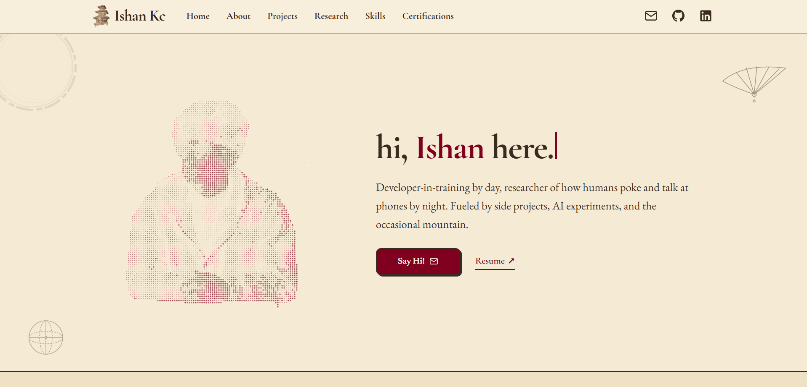

<div align="center">
  

  <h1>ishan kc - portfolio</h1>

  <p>
    A single-page portfolio built with
    <strong>Next.js 16</strong>, <strong>React 19</strong>,
    <strong>TypeScript</strong>, and <strong>Tailwind CSS v4</strong>.
  </p>
</div>

---



## 🛠️ set-up

1. Install the dependencies

   ```bash
   npm install
   ```

2. Start the development server

   ```bash
   npm run dev
   ```

   Open [http://localhost:3000](http://localhost:3000) in your browser.

3. Lint the project

   ```bash
   npm run lint
   ```

## 🚀 build and run for production

1. Generate a production build

   ```bash
   npm run build
   ```

2. Start the production server

   ```bash
   npm start
   ```

   Set `NEXT_PUBLIC_SITE_URL` before building so canonical metadata,
   `robots.txt`, and `sitemap.xml` use the public domain:

   ```bash
   NEXT_PUBLIC_SITE_URL=https://your-domain.com npm run build
   ```

   On Windows PowerShell:

   ```powershell
   $env:NEXT_PUBLIC_SITE_URL="https://your-domain.com"; npm run build
   ```

   On Vercel, `VERCEL_PROJECT_PRODUCTION_URL` and `VERCEL_URL` are used as
   fallbacks when `NEXT_PUBLIC_SITE_URL` is not set.

## 🖼️ image assets

Display-sized WebP files and the looping project preview are generated ahead
of time and served directly (no runtime image optimizer). Edit an original in
`assets/source/images`, then regenerate with:

```bash
npm run images
```

The script writes the optimised files to `public/images` and refreshes the
blur placeholders in `src/data/blur.ts`. It needs [sharp](https://sharp.pixelplumbing.com/)
and, for the MP4 preview, `ffmpeg` on the PATH. Keep generated filenames stable
(treat them as immutable) or rename the file when its contents change; the
`/images/*` cache headers are set to one year.

## 🎨 color codes

| Color | Hex |
| --- | --- |
| Parchment  | `#F5EAD4` |
| Deep Parchment  | `#EFE1C3` |
| Folio Card  | `#FAF0DC` |
| Iron Gall Ink  | `#3B2A20` |
| Soft Ink  | `#584141` |
| Burgundy  | `#800020` |
| Antique Gold  | `#B8923A` |
| Candlelight Cream  | `#FFF4E0` |

